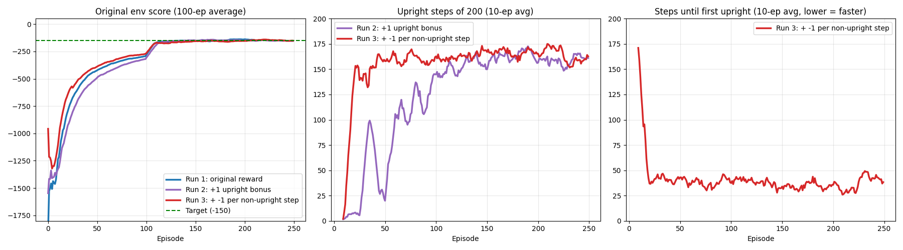

# Current task: hold +45° from upright

The active training and evaluation scripts target +45° with the original torque limit ±2.
Holding 45° at zero velocity requires approximately −3.54 Nm in this simulator;
therefore the ±2 version tests constrained tracking, not a feasible stationary equilibrium.
`target_control.py` shares environment settings, wrapped angle error, and reward.
The reward is `-(error² + 0.1*velocity² + 0.001*torque²)`; bonuses use ±0.1 rad around the target.
Logs report `near_target`; reaching the band once is not sustained balance.

```bash
OMP_NUM_THREADS=2 MKL_NUM_THREADS=2 python3 main.py --episodes 250 --out runs/angle45_torque2_default
python3 record_episode.py eval runs/angle45_torque2_default/ckpt 20
python3 record_episode.py live runs/angle45_torque2_default/ckpt
bash run_all.sh  # nine new runs under runs/angle45/
python3 compare_seeds.py
```

For a single-run dashboard, use `python3 monitor_run.py runs/angle45_torque2_default`.
It displays return, critic loss, Q, target occupancy, first crossing, effort, and final-100-step
mean absolute angle error, absolute angular speed, and signed mean torque.
Live Pygame evaluation reloads checkpoints every ten training episodes.
`upright` in the historical documentation below refers to the original 0° task.

A snapshot of the torque-2 training log is in `results/angle45_torque2/`.
It is an observation of this experiment, not evidence of sustained 45° balance.

Comparison outputs are `results_angle45_seeds.md/png`. Old checkpoints, logs,
videos and plots are preserved. `compare_runs.py` still evaluates historical upright
models using the original environment. Do not use the new recording script for old
upright checkpoints. The documentation below describes the historical upright version.

---

# DDPG — Pendulum Swing-Up (PyTorch)

Goal: train an agent that **swings a pendulum up from a random position and keeps it balanced upright**,
using Deep Deterministic Policy Gradient (DDPG). A follow-up to my
[DDPG LunarLander repo](https://github.com/boracelikors/ddpg-lunar-lander).

## The environment: `Pendulum-v1` (Gymnasium)

| | |
|---|---|
| Observation | `[cos θ, sin θ, θ̇]` (angle as cos/sin, angular velocity) |
| Action | torque ∈ **[-2, 2]** (1 continuous value) |
| Reward | `-(θ² + 0.1·θ̇² + 0.001·torque²)` per step, so 0 is best (upright, still, no effort) |
| Episode | always 200 steps (time limit only, no terminal state) |

The motor is too weak to lift the pendulum straight up. The agent has to learn to **swing back and forth to
build momentum**, then catch and balance it at the top.

Baseline, random policy (`random_baseline.py`, 10 seeds): **mean -1225**. Video: [`random_episode.mp4`](results/videos/random_episode.mp4).
A well-trained agent typically scores around **-150**.

## Credit

The DDPG agent (`ddpg_torch.py`) is **Phil Tabor's (Machine Learning with Phil)** PyTorch implementation from
[`philtabor/Youtube-Code-Repository`](https://github.com/philtabor/Youtube-Code-Repository/tree/master/ReinforcementLearning/PolicyGradient/DDPG/pytorch/lunar-lander),
which I first ran on LunarLander. Hyperparameters come from his
[TensorFlow2 Pendulum example](https://github.com/philtabor/Youtube-Code-Repository/tree/master/ReinforcementLearning/PolicyGradient/DDPG/tensorflow2/pendulum).
Shared for educational purposes.

## Changes for Pendulum

See `git log` for the exact diffs. The first commit is the unchanged LunarLander agent.

1. **Full torque range.** The actor outputs [-1, 1] (`tanh`); actions are multiplied by `max_action = 2` before
   `env.step`. Phil's TF2 Pendulum example leaves this out (see his own comment in `choose_action`), so his
   agent only uses half the available torque.
2. **Gaussian exploration noise** (σ = 0.1) instead of OU noise, as in the Pendulum example; plus an
   `evaluate` flag for noise-free actions.
3. **Correct bootstrapping on timeouts.** Pendulum never terminates, it only gets truncated at 200 steps,
   so the replay buffer stores `terminated` (always 0), not `terminated or truncated`.
4. Hyperparameters: actor lr 1e-3, critic lr 2e-3, τ = 0.005, batch 64, layers 400/300, γ = 0.99.
5. **Upright bonus (run 2).** `+1` reward on every step with |θ| < 0.1 rad (5.7°), to make the agent balance exactly
   vertical instead of at a tilt. The logged `score` stays the **original** env reward so runs are comparable;
   `upright N/200` counts the steps within 5.7°.
6. **Less exploration (run 2).** Gaussian noise σ 0.1 → 0.05 (DDPG's counterpart of DQN's ε).
7. **Time penalty (run 3).** `-1` reward on every step the pendulum is *not* upright, so slow swing-ups cost more.
   Combined with the bonus, the per-step gap between upright and not-upright grows from 1 to 2.
   `reach N` in the log is the first step at which the pendulum got upright.

## Setup and running

Run these commands from the repository root. Python 3.10 was used for the existing experiments.

```bash
python3 -m venv .venv
source .venv/bin/activate
python -m pip install -r requirements.txt

# Random policy: evaluate 10 episodes (add `video` to record the first)
python random_baseline.py

# Train with the current default reward: +1 upright, -1 non-upright
OMP_NUM_THREADS=1 python -u main.py --episodes 250 --out runs/my_experiment

# Evaluate without exploration noise, watch, or record
python record_episode.py eval runs/my_experiment/ckpt 20
python record_episode.py live runs/my_experiment/ckpt
python record_episode.py video runs/my_experiment/ckpt 0 runs/my_experiment/episode.mp4
```

Training writes `<out>/train.log` and four network checkpoints under `<out>/ckpt/`.
Without `--out`, these are `./train.log` and `./ckpt/`. Evaluation defaults to `./ckpt/`;
pass the checkpoint directory explicitly for named runs. Training saves every ten episodes
(including episode 0) and at the end. Reusing an output directory overwrites its log and
checkpoints; it starts a new model rather than resuming training. Checkpoints contain network
weights, not replay memory or optimizer state.

Options: `--episodes` (250), `--bonus` (1), `--penalty` (1), `--noise` (0.05),
`--seed` (0), and `--out` (`.`). Use `python main.py --help` for details.
Live viewing needs a desktop display; the monitor also needs Tk support for Matplotlib.

## Compare reward configurations

```bash
# Nine training processes: three configurations × three training seeds
bash run_all.sh
python live_monitor.py

# After training finishes: evaluate each model on the same 20 held-out starts
python compare_seeds.py
```

`run_all.sh` uses noise 0.05 for every configuration and one OpenMP thread per process.
It writes to `runs/{A_original,B_bonus,C_bonus_penalty}_s{0,1,2}/`.
The comparison generates `results_seeds.md` and `results_seeds.png` in the root;
its table reports mean ± standard deviation over training seeds. Training uses seeded
initialization, exploration, replay sampling, and environment resets; exact reproducibility
can still depend on hardware and library versions.

The historical comparison can be regenerated with:

```bash
python compare_runs.py run1 run2 run3
```

It needs local checkpoints in `tmp/run1`, `tmp/run2`, and `tmp/run3`, which are excluded
from Git. Historical logs and the existing comparison plot are included in `results/`.

## Project layout

| Path | Purpose |
|---|---|
| `main.py` | Training loop, reward shaping, logging, and checkpoints |
| `ddpg_torch.py` | Actor, critic, target networks, replay buffer, and DDPG updates |
| `random_baseline.py` | Random-policy evaluation and optional video |
| `record_episode.py` | Noise-free evaluation, live display, and video recording |
| `run_all.sh` | Three reward configurations across three training seeds |
| `compare_seeds.py` | Multi-seed evaluation and learning curves |
| `compare_runs.py` | Historical three-run evaluation and plot |
| `live_monitor.py` | Live curves from `runs/*_s*/train.log` |
| `utils.py` | Legacy learning-curve plotting helper |
| `results/` | Historical logs, videos, and plots |
| `runs/`, `ckpt/`, `tmp/` | Local experiment outputs and checkpoints (ignored) |

## Reading the training log

- `score`: sum of original environment rewards; higher is better.
- `upright`: steps within 0.1 radians of vertical, out of 200.
- `reach`: first upright step, or 200 if never reached; this does not measure sustained balance.
- `effort`: sum of squared torques.
- `closs`: mean critic loss for the episode's updates.
- `q`: mean predicted discounted shaped return on sampled replay batches.
- `trailing 100 games avg`: original score averaged over up to 100 episodes.

The actor produces normalized actions in [-1, 1]; the environment receives twice that value.
The replay buffer and critic use normalized actions. Learning starts after 64 transitions.
The OU noise class is retained from the original implementation, but action selection uses
Gaussian noise. Time-limit truncations stop an episode without cutting off value bootstrapping.

## Progress log

| Date | Run | Result |
|---|---|---|
| 2026-11-13 | Random policy baseline | mean -1225 (10 seeds) |
| 2026-11-13 | DDPG run 1 (noise 0.1, original reward), stopped at ep 209 | 100-ep avg **-143.6**; noise-free eval mean **-147.2**, but only **4%** of steps within 5.7° of vertical: it balances at a steady **9.3° tilt** with constant torque 0.79 (the θ² penalty for 9° is only ~-5/episode). [`results_run1.log`](results/logs/results_run1.log), [`episode_run1_seed0.mp4`](results/videos/episode_run1_seed0.mp4) |
| 2026-11-13 | DDPG run 2: +1 bonus per step within 5.7° of vertical, noise 0.05, 250 episodes | Noise-free eval mean **-131.7** (run 1: -147.2); **85%** of steps upright (run 1: 4%); steady-state angle **0.69°** (run 1: 9.3°). [`results_run2.log`](results/logs/results_run2.log), [`episode_run2_seed0.mp4`](results/videos/episode_run2_seed0.mp4) |
| 2026-11-13 | DDPG run 3: run 2 + `-1` per non-upright step, 250 episodes | **Learned much faster** (≥150 upright steps by episode ~20 vs ~100 in run 2), but the **final policy ≈ run 2**: first upright after 34.0 steps (run 2: 34.2), 83% upright, score -140.3. The shaping term is `2·up − 1`: compared with run 2 it doubles the upright bonus and adds a constant. The stronger bonus can change the optimal policy; these runs alone do not establish a physical limit on swing-up speed. [`results_run3.log`](results/logs/results_run3.log), [`episode_run3_seed0.mp4`](results/videos/episode_run3_seed0.mp4) |

**Noise-free comparison, same 20 seeds** (`python3 compare_runs.py run1 run2 run3`):

| Run | Score | Upright | Steps to first upright (mean / max) | Never upright | Steady tilt |
|---|---|---|---|---|---|
| 1 | -146.2 | 4% | 40.4 / 64 | 9 of 20 | 9.44° |
| 2 | **-134.9** | 83% | 34.2 / 53 | 0 | **0.65°** |
| 3 | -140.3 | 83% | **34.0** / 69 | 0 | 1.62° |



These are historical single-training-seed results, not the newer multi-seed experiment. Run 1 also used higher exploration noise, so the historical comparison does not isolate reward shaping alone.
