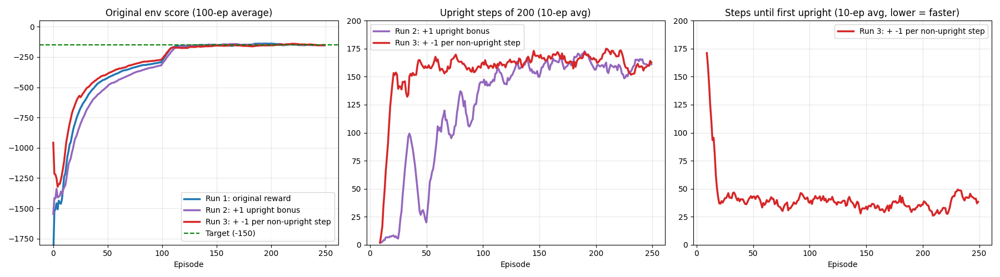

# DDPG — Pendulum Swing-Up (PyTorch)

Goal: train an agent that **swings a pendulum up from a random position and keeps it balanced upright**,
using Deep Deterministic Policy Gradient (DDPG). A follow-up to my
[DDPG LunarLander repo](https://github.com/boracelikors/ddpg-lunar-lander).

## The environment: `Pendulum-v1` (Gymnasium)

| | |
|---|---|
| Observation | `[cos θ, sin θ, θ̇]` (angle as cos/sin, angular velocity) |
| Action | torque ∈ **[-2, 2]** (1 continuous value) |
| Reward | `-(θ² + 0.1·θ̇² + 0.001·torque²)` per step, so 0 is best (upright, still, no effort) |
| Episode | always 200 steps (time limit only, no terminal state) |

The motor is too weak to lift the pendulum straight up. The agent has to learn to **swing back and forth to
build momentum**, then catch and balance it at the top.

Baseline, random policy (`random_baseline.py`, 10 seeds): **mean -1225**. Video: [`random_episode.mp4`](random_episode.mp4).
A well-trained agent typically scores around **-150**.

## Credit

The DDPG agent (`ddpg_torch.py`) is **Phil Tabor's (Machine Learning with Phil)** PyTorch implementation from
[`philtabor/Youtube-Code-Repository`](https://github.com/philtabor/Youtube-Code-Repository/tree/master/ReinforcementLearning/PolicyGradient/DDPG/pytorch/lunar-lander),
which I first ran on LunarLander. Hyperparameters come from his
[TensorFlow2 Pendulum example](https://github.com/philtabor/Youtube-Code-Repository/tree/master/ReinforcementLearning/PolicyGradient/DDPG/tensorflow2/pendulum).
Shared for educational purposes.

## Changes for Pendulum

See `git log` for the exact diffs. The first commit is the unchanged LunarLander agent.

1. **Full torque range.** The actor outputs [-1, 1] (`tanh`); actions are multiplied by `max_action = 2` before
   `env.step`. Phil's TF2 Pendulum example leaves this out (see his own comment in `choose_action`), so his
   agent only uses half the available torque.
2. **Gaussian exploration noise** (σ = 0.1) instead of OU noise, as in the Pendulum example; plus an
   `evaluate` flag for noise-free actions.
3. **Correct bootstrapping on timeouts.** Pendulum never terminates, it only gets truncated at 200 steps,
   so the replay buffer stores `terminated` (always 0), not `terminated or truncated`.
4. Hyperparameters: actor lr 1e-3, critic lr 2e-3, τ = 0.005, batch 64, layers 400/300, γ = 0.99.
5. **Upright bonus (run 2).** `+1` reward on every step with |θ| < 0.1 rad (5.7°), to make the agent balance exactly
   vertical instead of at a tilt. The logged `score` stays the **original** env reward so runs are comparable;
   `upright N/200` counts the steps within 5.7°.
6. **Less exploration (run 2).** Gaussian noise σ 0.1 → 0.05 (DDPG's counterpart of DQN's ε).
7. **Time penalty (run 3).** `-1` reward on every step the pendulum is *not* upright, so slow swing-ups cost more.
   Combined with the bonus, the per-step gap between upright and not-upright grows from 1 to 2.
   `reach N` in the log is the first step at which the pendulum got upright.

## Running

```bash
pip install torch gymnasium matplotlib imageio imageio-ffmpeg
python3 random_baseline.py video      # baseline + random_episode.mp4
python3 -u main.py 250 > train.log    # train (checkpoint every 10 episodes)
python3 live_monitor.py               # live learning curve
python3 record_episode.py live        # live simulation, reloads newest checkpoint
python3 record_episode.py eval        # noise-free mean over 10 seeds
python3 record_episode.py video tmp/ddpg 0 episode.mp4
```

## Progress log

| Date | Run | Result |
|---|---|---|
| 2026-11-13 | Random policy baseline | mean -1225 (10 seeds) |
| 2026-11-13 | DDPG run 1 (noise 0.1, original reward), stopped at ep 209 | 100-ep avg **-143.6**; noise-free eval mean **-147.2**, but only **4%** of steps within 5.7° of vertical: it balances at a steady **9.3° tilt** with constant torque 0.79 (the θ² penalty for 9° is only ~-5/episode). [`results_run1.log`](results_run1.log), [`episode_run1_seed0.mp4`](episode_run1_seed0.mp4) |
| 2026-11-13 | DDPG run 2: +1 bonus per step within 5.7° of vertical, noise 0.05, 250 episodes | Noise-free eval mean **-131.7** (run 1: -147.2); **85%** of steps upright (run 1: 4%); steady-state angle **0.69°** (run 1: 9.3°). [`results_run2.log`](results_run2.log), [`episode_run2_seed0.mp4`](episode_run2_seed0.mp4) |
| 2026-11-13 | DDPG run 3: run 2 + `-1` per non-upright step, 250 episodes | **Learned much faster** (≥150 upright steps by episode ~20 vs ~100 in run 2), but the **final policy ≈ run 2**: first upright after 34.0 steps (run 2: 34.2), 83% upright, score -140.3. Expected: `+1 up / -1 not up` = `2·up − 1`, i.e. a doubled bonus plus a constant that doesn't change the optimal policy; swing-up speed is limited by the max torque. [`results_run3.log`](results_run3.log), [`episode_run3_seed0.mp4`](episode_run3_seed0.mp4) |

**Noise-free comparison, same 20 seeds** (`python3 compare_runs.py run1 run2 run3`):

| Run | Score | Upright | Steps to first upright (mean / max) | Never upright | Steady tilt |
|---|---|---|---|---|---|
| 1 | -146.2 | 4% | 40.4 / 64 | 9 of 20 | 9.44° |
| 2 | **-134.9** | 83% | 34.2 / 53 | 0 | **0.65°** |
| 3 | -140.3 | 83% | **34.0** / 69 | 0 | 1.62° |


